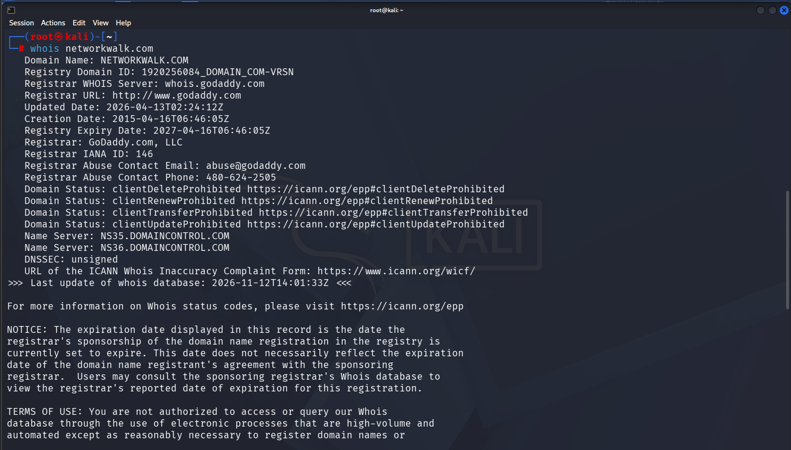
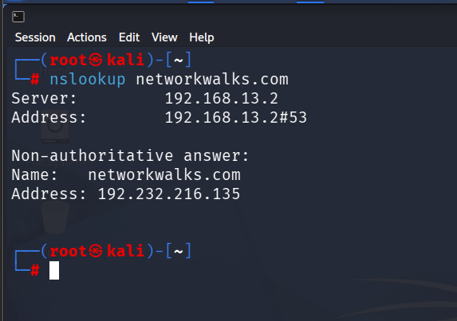
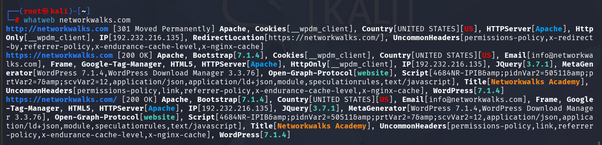
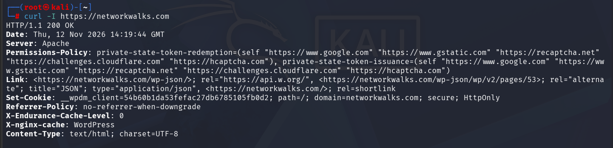
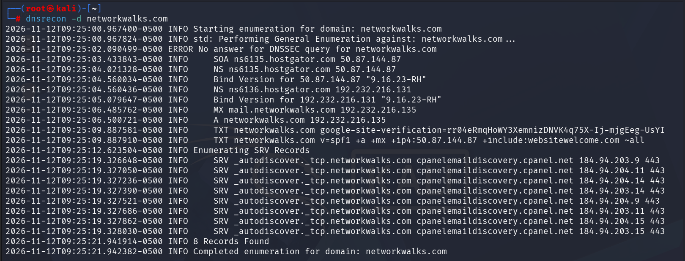

# 🔍 Website Information Gathering & Reconnaissance

## 🎯 Objective
To perform website reconnaissance and information gathering using Kali Linux tools. The objective is to collect publicly available domain information, identify DNS records, analyze web technologies, inspect HTTP headers, and detect Web Application Firewall (WAF) protection.

🌐 **Target Domain:** `networkwalks.com`

---

## 🥇 Step 1: WHOIS Lookup

🛠️ **Tool:** WHOIS

💻 **Command:**
```bash
whois networkwalks.com
```

📝 **Description:**

Performed a WHOIS lookup to gather domain registration information, registrar details, domain creation and expiry dates, name servers, and domain status.

📌 **Key Information Collected:**
- 🏢 Domain Registrar: GoDaddy
- 📅 Domain Creation and Expiry Dates
- 🌐 Name Server Information
- 🔐 Domain Status
- 🛡️ DNSSEC Information

📸 **Screenshot:**



---

## 🥈 Step 2: DNS Lookup

🛠️ **Tool:** NSLookup

💻 **Command:**
```bash
nslookup networkwalks.com
```

📝 **Description:**

Used NSLookup to resolve the target domain name into its corresponding IP address through the configured DNS server.

📌 **Key Findings:**
- 🌐 DNS Server: `192.168.13.2`
- 🎯 Resolved IP Address: `192.232.216.135`
- ✅ Successfully retrieved DNS resolution response.

📸 **Screenshot:**



---

## 🥉 Step 3: Website Technology Identification

🛠️ **Tool:** WhatWeb

💻 **Command:**
```bash
whatweb networkwalks.com
```

📝 **Description:**

Used WhatWeb to identify technologies, frameworks, CMS platforms, and other components running on the target website.

📌 **Key Findings:**
- 🖥️ Web Server: Apache
- 🌍 CMS: WordPress
- ⚙️ WordPress Version: 7.1.4 (reported)
- 📚 JavaScript Library: jQuery 3.7.1
- 🎨 Framework: Bootstrap 7.1.4 (reported)
- 🏷️ Website Title: NetworkWalks Academy

📸 **Screenshot:**



---

## 🌐 Step 4: HTTP Header Analysis

🛠️ **Tool:** cURL

💻 **Command:**
```bash
curl -I https://networkwalks.com
```

📝 **Description:**

Used cURL to send an HTTP HEAD request and inspect the server response headers.

📌 **Key Findings:**
- ✅ HTTP Status: `200 OK`
- 🖥️ Web Server: Apache
- 📄 Content-Type: text/html
- 🔐 Security-related headers and cookie attributes observed.
- ⚙️ WordPress-related HTTP response headers identified.

📸 **Screenshot:**



---

## 🛡️ Step 5: Web Application Firewall Detection

🛠️ **Tool:** WAFW00F

💻 **Command:**
```bash
wafw00f networkwalks.com
```

📝 **Description:**

Used WAFW00F to identify whether the target website is protected by a Web Application Firewall (WAF).

📌 **Key Findings:**
- ✅ WAF Detection: Positive
- 🛡️ Identified WAF: ModSecurity (SpiderLabs)
- 📊 Number of Requests: 2

📸 **Screenshot:**


---

## 🔎 Step 6: DNS Enumeration

🛠️ **Tool:** DNSRecon

💻 **Command:**
```bash
dnsrecon -d networkwalks.com
```

📝 **Description:**

Performed DNS enumeration to identify publicly available DNS records associated with the target domain.

📌 **Key Findings:**
- 📡 SOA Records Identified
- 🌐 NS (Name Server) Records Retrieved
- 🎯 A Records Identified
- 📧 MX (Mail Exchange) Records Retrieved
- 📝 TXT Records Identified
- 🔗 SRV Records Enumerated
- 📊 Total Records Reported: 8

📸 **Screenshot:**



---

## 📊 Conclusion

Successfully completed the website reconnaissance process using Kali Linux.

### ✅ Practical Tasks Completed

- 🔍 Domain information gathering using WHOIS.
- 🌐 DNS resolution using NSLookup.
- 🖥️ Website technology identification using WhatWeb.
- 📡 HTTP response header analysis using cURL.
- 🛡️ Web Application Firewall detection using WAFW00F.
- 🔎 DNS enumeration using DNSRecon.

### 💡 Learning Outcomes

- Understanding website reconnaissance techniques.
- Identifying publicly available domain information.
- Analyzing DNS records and web technologies.
- Understanding HTTP response headers.
- Identifying WAF protection mechanisms.

---

## 🧰 Tools & Technologies

| Tool | Purpose |
|---|---|
| 🔍 WHOIS | Domain Information Gathering |
| 🌐 NSLookup | DNS Resolution |
| 🖥️ WhatWeb | Technology Identification |
| 📡 cURL | HTTP Header Analysis |
| 🛡️ WAFW00F | WAF Detection |
| 🔎 DNSRecon | DNS Enumeration |

---

### 👨‍💻 Environment
- 🐉 Operating System: Kali Linux
- 🔐 Domain: `networkwalks.com`
- 📂 Category: Cybersecurity | Information Gathering | Reconnaissance

**⚠️ Disclaimer:** All testing should be performed only on systems for which proper authorization has been obtained.
